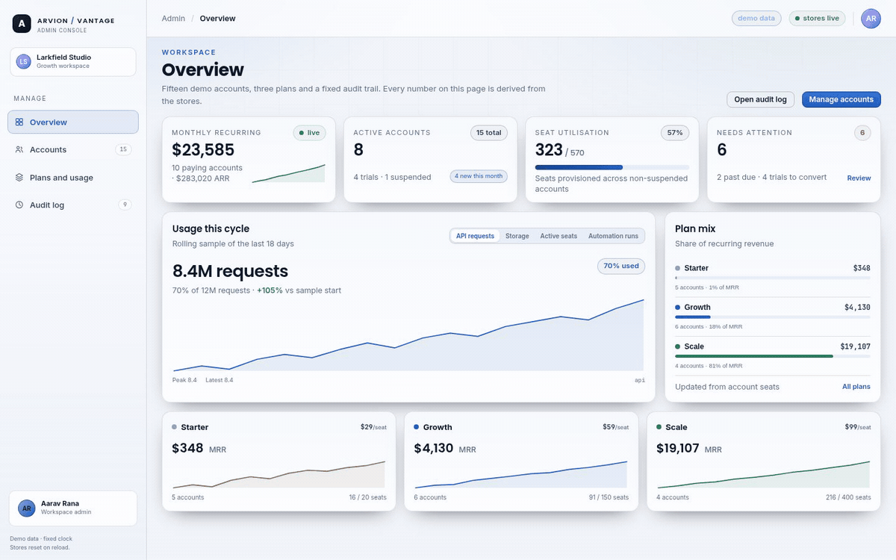

<div align="center">

</div>

<sub>Recorded from the live demo &middot; <a href="docs/demo.mp4">MP4</a> &middot; <a href="docs/screenshot.png">static frame</a></sub>

# Vantage

A billing admin console built with Vue 3 and the composition API. Accounts can
be filtered, selected in bulk and changed; plan and usage cards show the shape of
the month; the audit log records every change with a before and after diff. The
point of the sample is state management: typed stores with pure actions, and
views that never mutate data directly.

[**Live demo**](https://arvion-technology.github.io/labs/demos/vantage/demo/) &middot; [MIT](LICENSE)

---

## What it does

- **Accounts:** search, plan and status filters, sortable columns, row selection
  and bulk plan changes.
- **Plans and usage:** revenue by plan, seat utilisation and a sparkline per plan
  computed from the same usage series the accounts view uses.
- **Audit log:** every mutation appends an entry with actor, wait time and a field
  level diff; the diff view renders additions and removals line by line.
- **Notes and export:** a per-account note field and CSV export of the current
  filtered selection.
- **Undo for bulk changes:** one action, one revert, using snapshots.

## How it is built

Vue 3 with `<script setup>` and TypeScript, bundled by Vite. The stores are plain
reactive modules (`src/stores/`) whose actions are pure functions over typed data,
so they can be tested without mounting a component. Components are small and
presentational; views compose them.

```
src/
  stores/accounts.ts   filters, selection, bulk plan change
  stores/audit.ts      append-only log with diffs
  stores/ui.ts         toasts, active view
  views/               Overview, Plans, Accounts, Audit
  components/          Sparkline, StatusBadge, DiffView
  lib/admin-core.ts    sorting, filtering, diffing, CSV
test/admin-core.test.ts
```

The demo in `demo/` is the Vite build with relative asset paths, produced by
`scripts/postbuild.mjs`, so the gallery can serve it as static files.

## Run it

```bash
npm ci
npm run dev
npm test           # node:test with type stripping on the pure store logic
npm run typecheck  # vue-tsc
npm run build      # dist/ and demo/
```

## Tests

The test suite exercises the pure logic: filtering and sorting, diff generation,
CSV quoting and the audit entry shape. Component rendering is left to the
typechecker and the demo.

## Honest limitations

- Data is seeded and local. There is no API, no authentication and no
  persistence beyond the session.
- The audit log records client side actions; a real system would append on the
  server and sign the entries.
- The sparkline is a simple SVG polyline, not a full charting component.

## What to look at first

Select two accounts, change their plan in bulk, then open the audit view: every
selected account has an entry with a field level diff. Undo once and the accounts
return to their previous plan, and the audit log records the revert as a new
event rather than erasing history.


The CSV export is asserted against the filter result in tests, because an export that quietly ignores the current filters is worse than no export.
## License

MIT. See [LICENSE](LICENSE).
